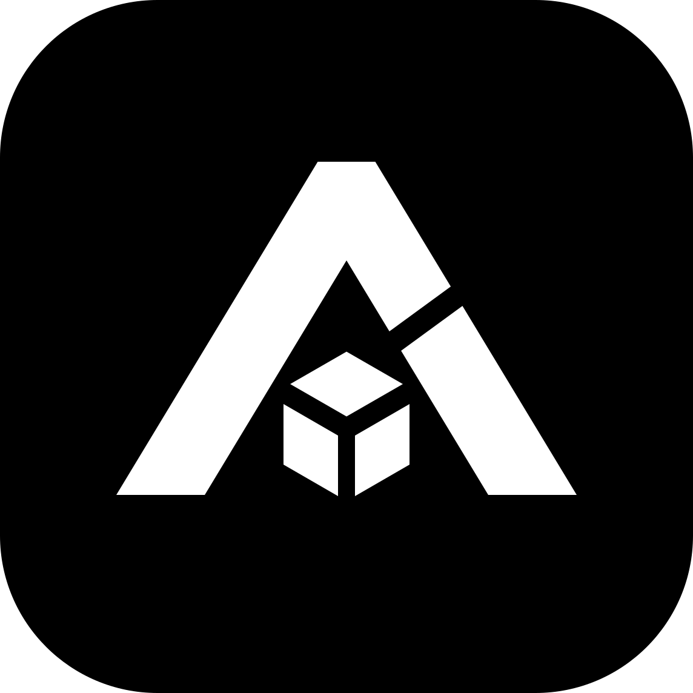

# Agate

A light Minecraft Java launcher for Windows, written in Rust (Tauri 2).

- **Profiles**: each one has its own pixel-art icon (10 designs × 5 colours) and its own Minecraft version, loader (Vanilla, Fabric, OptiFine), memory, worlds and content. The profile page shows the rotating panorama of its version, as on the title screen, together with your 3D skin.
- **Play installs everything**: game, libraries, assets and the right Java (Eclipse Temurin 8/17/21/25) are downloaded on the first launch.
- **Modrinth**: mods (Fabric), texture packs and shaders, each with its own browser. Dependencies are installed automatically, at a version compatible with the mod that requires them (stable releases first). Texture packs and shaders are activated as soon as they are installed. A shader on a Fabric profile brings Iris and Sodium with it.
- **OptiFine** for every version where it exists, including "preview" builds (the only ones for 26.x and 1.21.6–1.21.10), downloaded from optifine.net and patched locally.
- **Worlds and screenshots**: worlds list with "Entra" to load straight into the world (Minecraft 1.20+), screenshot gallery.
- **Skin**: 3D view of your skin (drag to rotate it), skin change from a PNG file (classic or slim model).
- **Custom cape (seen only by you)**: in Settings → Mantello personalizzato you create a cape from any PNG or JPG (fill/fit, edge colour) and can edit it again later. On Fabric 26.x profiles the launcher adds the **Agate Cape** mod (`cape-mod/`, 4 KB), which shows it on your player only. Nothing is sent to Mojang: other players keep seeing your Microsoft cape.
- **Import** (optional): on the New profile page, "Importa da un altro launcher" finds Modrinth App, CurseForge and Prism Launcher instances; you tick the ones you want and Agate copies worlds, mods, packs, shaders and settings into new profiles. The originals stay untouched. Vanilla and Fabric only (Forge/NeoForge/Quilt are shown as not supported).
- **Saved servers**: in the Mondi e server tab, with "Entra" to connect directly (1.20+).
- **Shared settings**: `options.txt` (keys, video, audio…) and `servers.dat` synced between all profiles that have the option enabled.
- **Accounts**: Microsoft (code shown in the app, you sign in at microsoft.com/link) or an offline name.
- **Crash explained**: if the game closes with an error, the launcher reads the log and says why (e.g. incompatible mods).
- **Updates from the app**: Agate checks GitHub Releases at startup; when a new version exists a small "Aggiorna" chip appears in the titlebar (and in Settings → Preferenze). One click downloads the signed installer, installs it and reopens the app. Profiles and worlds are not touched.
- **Antivirus with HTTPS scanning** (e.g. Norton Web Shield): Java uses the Windows certificate store, so skins and online login work anyway.

## Running

```bash
cd src-tauri
cargo build --release
```

The executable is `src-tauri/target/release/agate.exe`. For an installer: `cargo install tauri-cli --version "^2"` then `cargo tauri build` (NSIS).

## Releasing an update

Updates are signed: the public key is in `src-tauri/tauri.conf.json` (`plugins.updater`), the private key stays outside the repository (`%USERPROFILE%\.tauri\agate-updater.key` by default). Keep a backup of it: without it, installed copies can no longer be updated automatically.

1. Raise `version` in `src-tauri/tauri.conf.json` (and `src-tauri/Cargo.toml`).
2. Run `.\release.ps1 -Notes "What changed" -Publish`: it builds the installer, signs it, writes `latest.json` and creates the GitHub release `v<version>` with both files (needs `gh`).

The app reads `https://github.com/MooseDevPJS/agate/releases/latest/download/latest.json`. A fork must generate its own key (`tauri signer generate`) and change the endpoint and public key.

## Data

Everything lives in `%APPDATA%\Agate`:

| Folder | Contents |
|---|---|
| `instances/<id>` | game folder for each profile (saves, mods, config) |
| `shared/` | shared `options.txt`, `options-legacy.txt`, `servers.dat` |
| `versions/`, `libraries/`, `assets/` | shared game files |
| `runtimes/java-N` | downloaded Java runtimes |
| `profiles.json`, `accounts.json`, `settings.json` | launcher state |

Agate was called **Blocco** until 0.2.0. On its first start Agate renames `%APPDATA%\Blocco` to `%APPDATA%\Agate` (instant, nothing is copied): profiles, worlds, accounts and settings carry over. The 0.2.0 installer, run by Blocco's updater, installs Agate next to the old folder, gives it the shortcuts Blocco had and removes the old app.

`accounts.json` holds the Microsoft refresh token in plain text, as other launchers do: don't share it.

## Microsoft login

By default the device-code login uses the public client ID of the official Minecraft launcher (the same approach used by several open-source launchers). If you have an Azure app approved by Mojang, enter its ID in Settings → Advanced Microsoft sign-in.

## Development

`ui/` is static HTML/CSS/JS with no bundler (`skin.js` contains the 3D player and the panorama cube). Images in the data folder are served by the app's `agate://` protocol, limited to that folder.

```bash
cd src-tauri && cargo test
```

The cape mod is rebuilt with `bash cape-mod/build.sh` (needs a JDK 25 in `.tools/` and Minecraft 26.3 + Fabric installed by Agate). It doesn't use Gradle: 26.x isn't obfuscated, so the names in the code are the ones the game uses. The jar ends up in `src-tauri/assets/` and is built into the launcher.

## Notice

NOT AN OFFICIAL MINECRAFT PRODUCT. NOT APPROVED BY OR ASSOCIATED WITH MOJANG OR MICROSOFT. Agate contains no game files: Minecraft, its assets and Java are downloaded from the official sources on the user's computer. OptiFine, Fabric and Modrinth content belong to their authors.

## License

MIT, see [LICENSE](LICENSE). The Archivo font is under the SIL Open Font License (`ui/fonts/OFL-archivo.txt`).
